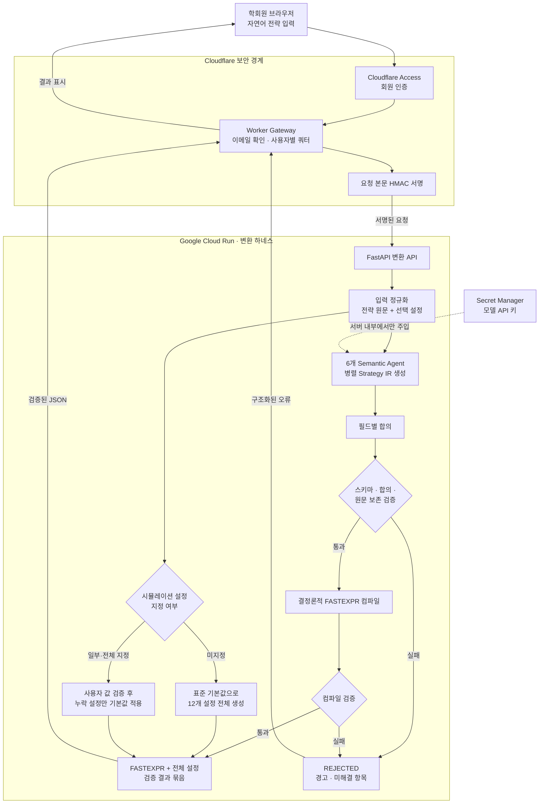

# 자연어 BRAIN Alpha 변환 하네스

한국어 또는 영어로 작성한 퀀트 아이디어를 WorldQuant BRAIN에서 사용할 수 있는 FASTEXPR 후보와 전체 시뮬레이션 설정으로 변환하는 검증형 웹 서비스입니다.

단순히 모델이 코드를 바로 작성하게 하지 않습니다. 여러 의미 분석 결과를 구조화된 `Strategy IR`로 합의한 뒤, Python 컴파일러가 허용된 문법만 결정론적으로 생성합니다. 전략의 조건이나 숫자가 사라지면 결과를 내보내지 않고 `REJECTED`로 처리합니다.

> 현재 목표 환경은 약 20명의 학회원과 월 1,000회 요청입니다. BRAIN 로그인, 시뮬레이션 실행, Alpha 제출은 자동화하지 않습니다.

## 주요 기능

- 자연어 전략을 구조화된 Strategy IR로 변환
- 6개 Semantic Agent의 결과를 필드별 다수결로 합의
- 스키마, 합의 신뢰도, 원문 조건 보존 여부 검증
- 검증된 IR만 결정론적 FASTEXPR로 컴파일
- 설정을 생략해도 BRAIN 시뮬레이션 설정 12개를 항상 반환
- 자연어 설정, 명시적 API 설정, 기본값의 출처를 필드별로 표시
- 검증 실패 시 임의 코드를 반환하지 않고 원인을 포함한 `REJECTED` 응답 반환
- Cloudflare Access 인증, 사용자별 요청 제한, HMAC 기반 백엔드 보호
- Cloud Run scale-to-zero와 최대 인스턴스 제한을 통한 비용 제어
- API 키 없이 화면과 흐름을 개발할 수 있는 결정론적 Mock Provider 제공

## 시스템 작동 흐름



브라우저는 모델 공급자와 직접 통신하지 않습니다. 모델 API 키는 Cloud Run의 Secret으로만 주입하고, 운영 모드의 변환 API는 유효한 Gateway 서명이 없는 요청을 거부합니다.

## 변환 과정

1. 사용자가 자연어 전략과 필요한 경우 시뮬레이션 설정을 입력합니다.
2. 운영 환경에서는 Cloudflare Access가 사용자를 인증하고 Worker가 분당·일일 요청 한도를 확인합니다.
3. Worker는 요청 본문을 HMAC-SHA256으로 서명해 Cloud Run에 전달합니다.
4. 6개 Semantic Agent가 같은 전략을 서로 다른 관점에서 독립적으로 해석합니다.
5. 하네스가 각 IR 필드의 다수결 결과와 신뢰도를 계산합니다.
6. 원문에 있는 숫자, 방향, 거래량 조건, 중립화 조건이 보존됐는지 검사합니다.
7. 검증을 통과한 IR만 Python 컴파일러가 FASTEXPR로 변환합니다.
8. 설정 해석기가 사용자 값을 우선 적용하고 빠진 값을 기본 프로필로 채웁니다.
9. FASTEXPR, 전체 설정, 설정 출처, 신뢰도, 검증 결과와 경고를 하나의 JSON으로 반환합니다.

## 기본 시뮬레이션 설정

별도 설정이 없을 때 아래 12개 값을 모두 반환합니다. 자연어 또는 요청 JSON에 설정이 있으면 해당 값이 우선하며 나머지만 기본값으로 채웁니다.

| 설정 | 기본값 |
| --- | --- |
| Language | `FASTEXPR` |
| Instrument Type | `EQUITY` |
| Region | `USA` |
| Universe | `TOP3000` |
| Delay | `1` |
| Neutralization | `SUBINDUSTRY` |
| Decay | `4` |
| Truncation | `0.08` |
| Pasteurization | `ON` |
| Unit Handling | `VERIFY` |
| NaN Handling | `OFF` |
| Test Period | `0 years / 0 months` |

설정 출처는 다음 우선순위를 갖습니다.

1. `override`: API의 `settings` 객체로 명시한 값
2. `user`: 자연어 전략에서 인식한 값
3. `default`: 명시되지 않아 기본 프로필로 채운 값

현재 배포 프로필은 `USA`와 `TOP200`, `TOP500`, `TOP1000`, `TOP2000`, `TOP3000` Universe를 지원합니다. 지원하지 않는 Region이나 설정은 조용히 무시하지 않고 `unresolvedSettings`와 `warnings`에 표시합니다.

## 빠른 시작

### 요구 사항

- Python 3.11 이상
- `make`
- Gateway를 수정하거나 배포할 경우 Node.js 22 이상
- 컨테이너를 확인할 경우 Docker

### API 키 없이 로컬 실행

```bash
git clone https://github.com/blockcoder-sj/natural-language-brain-alpha-harness.git
cd natural-language-brain-alpha-harness
make install
make dev
```

브라우저에서 `http://localhost:8080`을 엽니다. 개발 명령은 `APP_ENV=development`, `HARNESS_PROVIDER=mock`을 사용하므로 외부 모델을 호출하거나 비용을 발생시키지 않습니다.

개발 환경의 API 문서는 `http://localhost:8080/api/docs`에서 확인할 수 있습니다. 운영 환경에서는 API 문서를 비활성화합니다.

### 실제 모델 연결

`.env.example`은 필요한 변수의 이름만 보여주는 템플릿입니다. 실제 키를 파일이나 Git 저장소에 커밋하지 말고 배포 환경의 Secret Manager에 직접 등록하세요.

```bash
APP_ENV=development \
HARNESS_PROVIDER=openai \
OPENAI_API_KEY='직접_발급한_키' \
.venv/bin/uvicorn backend.app.main:app --reload --port 8080
```

이 예시는 사용자가 직접 발급한 키로 로컬 프로세스를 실행하는 방법만 설명합니다. 저장소에는 API 키가 포함되어 있지 않습니다.

## API 사용법

### 상태 확인

```http
GET /api/health
```

```json
{
  "status": "ok",
  "provider": "mock"
}
```

Provider가 첫 요청 전까지 초기화되지 않았다면 `provider`가 `not-initialized`로 표시될 수 있습니다.

### 전략 변환

```http
POST /api/convert
Content-Type: application/json
```

가장 단순한 요청:

```json
{
  "strategy": "최근 5일 동안 많이 떨어진 종목을 매수한다."
}
```

일부 설정을 명시하는 요청:

```json
{
  "strategy": "최근 5일 동안 많이 떨어진 종목을 매수한다.",
  "settings": {
    "universe": "TOP1000",
    "delay": 1,
    "neutralization": "SECTOR",
    "decay": 6,
    "truncation": 0.05
  }
}
```

대표 응답:

```json
{
  "requestId": "c788a1d9-0000-4000-8000-111111111111",
  "status": "PASS",
  "fastExpression": "rank(-ts_delta(close, 5))",
  "simulationSettings": {
    "language": "FASTEXPR",
    "instrumentType": "EQUITY",
    "region": "USA",
    "universe": "TOP3000",
    "delay": 1,
    "neutralization": "SUBINDUSTRY",
    "decay": 4,
    "truncation": 0.08,
    "pasteurization": "ON",
    "unitHandling": "VERIFY",
    "nanHandling": "OFF",
    "testPeriod": {"years": 0, "months": 0}
  },
  "settingsSource": {
    "language": "default",
    "instrumentType": "default",
    "region": "default",
    "universe": "default",
    "delay": "default",
    "neutralization": "default",
    "decay": "default",
    "truncation": "default",
    "pasteurization": "default",
    "unitHandling": "default",
    "nanHandling": "default",
    "testPeriod": "default"
  },
  "confidence": 1.0,
  "validation": {
    "jsonValid": true,
    "schemaValid": true,
    "consensusPassed": true,
    "sourceRequirementsPreserved": true,
    "compilePassed": true
  },
  "warnings": [
    "명시되지 않은 설정은 표준 첫 시뮬레이션 기본값으로 채웠습니다."
  ],
  "unresolvedSettings": [],
  "provider": "mock"
}
```

실제 응답에는 합의된 `strategyIR`도 포함됩니다. `status`가 `REJECTED`이면 `fastExpression`은 `null`이며 실패 원인은 `warnings`에 들어갑니다.

## 환경 변수

| 변수 | 기본값 | 설명 |
| --- | --- | --- |
| `APP_ENV` | `development` | `production`일 때 Gateway 서명을 요구하고 API 문서를 끕니다. |
| `HARNESS_PROVIDER` | `openai` | `openai` 또는 로컬 개발·테스트용 `mock`입니다. |
| `OPENAI_API_KEY` | 없음 | OpenAI Provider 사용 시 필요한 서버 전용 Secret입니다. |
| `OPENAI_MODEL` | `gpt-5-mini` | Semantic Agent가 사용할 모델입니다. |
| `GATEWAY_SHARED_SECRET` | 없음 | Worker와 Cloud Run이 공유하는 HMAC 서명 키입니다. |
| `ALLOWED_EMAILS` | 비어 있음 | 쉼표로 구분한 추가 허용 이메일 목록입니다. |
| `MAX_CONCURRENT_JOBS` | `2` | 동시에 실행할 수 있는 전체 변환 작업 수입니다. |
| `MODEL_TIMEOUT_SECONDS` | `40` | 개별 모델 요청 제한 시간입니다. |

## 프로젝트 구조

```text
backend/
├── app/
│   ├── main.py          FastAPI 애플리케이션 팩토리와 라우트
│   ├── config.py        환경설정 캡슐화
│   ├── models.py        요청, 응답, Strategy IR 스키마
│   ├── provider.py      모델 Provider 인터페이스와 구현체
│   ├── service.py       Agent 병렬 실행, 합의, 전체 변환 흐름
│   ├── compiler.py      결정론적 FASTEXPR 컴파일과 보존 검사
│   ├── settings.py      12개 시뮬레이션 설정 해석과 기본값
│   ├── security.py      Gateway HMAC와 이메일 검증
│   └── static/          대시보드와 분리된 브라우저 모듈
├── tests/               설정, 컴파일러, 서비스, API 테스트
gateway/
├── src/index.ts         Cloudflare Access, KV 쿼터, 요청 서명
├── wrangler.jsonc       Worker와 KV 바인딩 설정
└── package.json         Gateway 개발·검사 명령
docs/
├── ARCHITECTURE.md      신뢰 경계와 데이터 정책
├── DECISIONS.md         확정된 제품·설정 결정
├── OPERATIONS.md        비용, 한도, 관찰 지표
└── USER_SETUP.md        사용자가 직접 해야 할 배포 설정
.github/workflows/
├── ci.yml               백엔드, 프런트엔드, Gateway 검사
├── deploy-cloud-run.yml 수동 Cloud Run 배포
└── deploy-gateway.yml   수동 Cloudflare Worker 배포
```

각 계층은 직접 결합하지 않고 명시적인 모델과 인터페이스를 통해 통신합니다. 예를 들어 모델 공급자는 `SemanticProvider` Protocol 뒤에 캡슐화되어 있으므로 향후 로컬 모델이나 다른 API로 교체할 때 합의·검증·컴파일러를 수정할 필요가 없습니다.

## 테스트와 품질 검사

```bash
make test
make lint
npm --prefix gateway ci
npm --prefix gateway run check
```

테스트는 외부 모델을 호출하지 않습니다. GitHub Actions에서는 다음 세 작업을 독립적으로 검사합니다.

- Backend: Ruff와 Pytest
- Frontend: 브라우저 ES Module 문법
- Gateway: TypeScript 타입 검사

Docker가 실행 중이면 다음 명령으로 배포 이미지도 확인할 수 있습니다.

```bash
make docker-build
```

## 배포 구조

### Google Cloud Run

- FastAPI, 정적 대시보드, 변환 하네스를 하나의 컨테이너로 배포합니다.
- 최소 인스턴스 `0`, 최대 인스턴스 `2`, 동시성 `20`으로 구성합니다.
- 모델 키와 Gateway 공유 Secret은 Secret Manager에서 주입합니다.
- GitHub의 `Deploy Cloud Run` 워크플로는 수동 실행만 가능합니다.

### Cloudflare Worker

- Cloudflare Access가 인증한 이메일만 전달받습니다.
- 사용자당 기본 한도는 분당 2회, 일일 20회입니다.
- KV를 이용해 사용량을 집계하고 초과 요청에는 `429`를 반환합니다.
- Cookie와 Authorization 헤더를 백엔드로 그대로 전달하지 않습니다.
- 요청 본문을 HMAC으로 서명해 Cloud Run의 직접 호출을 차단합니다.

실제 계정에서 해야 할 작업은 [사용자 배포 체크리스트](docs/USER_SETUP.md)를 따르세요. 배포 워크플로는 키와 계정 설정이 준비된 뒤 사용자가 직접 실행합니다.

## 보안과 데이터 처리

- 브라우저 코드에 모델 API 키를 포함하지 않습니다.
- 저장소는 `.env`, `.env.local`, 가상환경, `node_modules`를 추적하지 않습니다.
- BRAIN 이메일, 비밀번호, Cookie 또는 세션을 입력받지 않습니다.
- 전략 원문과 생성 코드를 데이터베이스에 영구 저장하지 않습니다.
- 운영 API 응답은 `Cache-Control: no-store`로 전달합니다.
- FastAPI는 CSP, clickjacking 방지, MIME sniffing 방지 헤더를 설정합니다.
- 운영 모드에서는 `/api/convert`에 유효한 HMAC 서명과 허용된 사용자를 요구합니다.

## 운영 규모와 예상 비용

기본 운영 목표는 약 20명, 월 1,000회 요청입니다. 1회 요청에서 6개 Agent가 각각 입력 900토큰과 출력 180토큰을 사용한다는 가정에서 모델 비용은 월 약 `$3.51`로 추정했습니다. Cloud Run은 scale-to-zero, Cloudflare는 무료 구간을 우선 사용하며 초기 월 hard limit은 `$10`을 권장합니다.

이는 고정 가격이 아니라 토큰 사용량과 공급자 가격에 따른 계획값입니다. 실제 운영에서는 요청 수, 입력·출력 토큰, 오류율과 월 예산 사용률을 함께 관찰해야 합니다. 자세한 기준은 [운영 문서](docs/OPERATIONS.md)에 있습니다.

## 현재 범위와 제한사항

- 지원하는 FASTEXPR 문법은 의도적으로 제한되어 있습니다. 현재 IR은 가격·거래량·수익률 필드, 변화량 또는 원시 신호, 상대 순위, 평균 거래량 진입 조건을 중심으로 합니다.
- 복잡한 다중 신호 조합, 사용자 정의 연산자, 자동 Exit 표현식은 아직 지원하지 않습니다.
- Mock Provider는 UI와 파이프라인 개발용이며 실제 모델 품질을 대신하지 않습니다.
- 지원하지 않는 전략이나 합의가 낮은 전략은 억지로 컴파일하지 않고 거부합니다.
- 생성 결과는 시뮬레이션 전 초안입니다. 수익률을 보장하지 않으며 투자 조언이 아닙니다.
- BRAIN 로그인, 백테스트 실행, Alpha 제출은 사용자가 직접 수행합니다.

## 관련 문서

- [아키텍처와 신뢰 경계](docs/ARCHITECTURE.md)
- [제품 및 기술 결정](docs/DECISIONS.md)
- [운영·비용·장애 기준](docs/OPERATIONS.md)
- [사용자가 직접 설정할 항목](docs/USER_SETUP.md)
- [기여 가이드](CONTRIBUTING.md)

