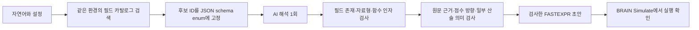

# BRAIN 필드·문법 호환성 조사와 수정 · 2026-11-03

조사 기준은 `superjin1218/brainconverter`의 `fbc3e7606b1c2fc3078b9004dc0c5fda361223aa`입니다. 기존 로컬 저장소의 6개 필드 제한은 이 최신 커밋에서 이미 해제되어 있었습니다. 수정은 `fix/brain-catalog-validation` 브랜치에서 수행했습니다. 운영 사이트를 재배포하거나 main에 병합하지 않았습니다.

## 사용자 추가 지적: 변수 정의와 BRAIN 프로그램 구문

사용자 요청에 따라 **실제 BRAIN 로그인·Simulate 검증은 작업 범위에서 제외합니다.** 추가 AI 호출도 하지 않습니다. 이후 검증은 코드 분석과 오프라인 테스트로만 진행합니다.

`roe`는 확보한 카탈로그의 제공 필드가 아닙니다. `return_equity`는 `Return on Equity`라는 설명의 제공 필드이므로 바로 참조할 수 있습니다. 직접 정한 이름 `roe`를 사용하려면 앞에서 정의해야 합니다. 예를 들어 제공 필드에 로컬 변수 이름을 붙이는 프로그램은 다음과 같습니다.

```text
roe = return_equity;
group_rank(roe, industry)
```

계산으로 지표를 만들 때도 실제 입력 필드로 계산한 뒤 선언·참조합니다. 기존 검사기는 Python AST의 단일 expression만 처리해 BRAIN의 `이름 = 계산식; 마지막출력식` 프로그램을 처리하지 못했습니다. 이를 보완해 선언 순서, 미정의 이름, 순환/중복 정의, 제공 필드·함수 이름 덮어쓰기, 변수 자료형, 미사용 선언, 전개 복잡도를 검사합니다. Python `exec`나 `eval`은 사용하지 않습니다.

복합 측정식은 이제 `calc_1 = 계산식;`처럼 선언하고 최종 점수식에서 `rank(calc_1)`로 참조합니다. 원문 조건과 점수 방향은 변수를 전개한 AST로 다시 검사해 선언 때문에 기존 검증을 우회하지 못하게 합니다. 원자료 제공 필드를 사용하는 단일 수식에는 불필요한 변수 선언을 강제하지 않습니다. 아래 10회 실제 AI 기록은 이 보완 전의 기록이며, 추가 API 호출 없이 오프라인으로 새 렌더링을 검사했습니다.

## 재현한 문제

운영 UI에 **“같은 산업에 속한 기업끼리 비교해서 자기자본이익률(ROE)이 높을수록 높은 점수를 주세요.”**를 입력했을 때 `group_rank(roe, industry)`가 PASS로 나왔습니다. 확보된 BRAIN 메타데이터 내보내기에는 `roe`가 없고, `return_equity`가 MATRIX 자료형과 `Return on Equity` 설명으로 존재합니다. 현재 계정에서의 실제 조회·시뮬레이션 성공까지 확인한 결과는 아닙니다.

기존 `data_fields.py`는 영문 식별자 형식만 검사했습니다. `models.py`의 필드도 열린 문자열이었고 시스템 프롬프트는 모델 지식으로 필드 이름을 고르게 했습니다. 따라서 가상의 `model_profitability_a`도 통과했습니다. 기존 자동 테스트가 이 성공을 기대하고 있어 555개 테스트 통과가 BRAIN 호환성을 증명하지 못했습니다.

`draft_compiler.py`는 모든 식별자를 동일한 숫자 시계열로 취급했습니다. 실제 내보내기에는 MATRIX 외에 VECTOR·GROUP·SYMBOL·UNIVERSE도 있습니다. VECTOR를 `rank`나 `ts_mean`에 바로 넣는 자료형 오류를 구별하지 못했고, 벡터 집계 연산자도 없었습니다. 한편 함수 이름 자체는 기존에도 제한 목록을 사용했습니다. 확인한 주된 결함은 모든 연산자를 무제한 허용하는 구조라기보다 **필드 이름·자료형을 검증하지 않은 채 제한된 연산자와 결합하는 구조**입니다.

기존 10개 측정 연산으로는 `(현금흐름-순이익)/총자산` 같은 복합식을 하나의 측정값으로 표현할 수 없었습니다. 실제 AI 검증에서 산술 단계를 별도 순위 점수로 쪼개거나 비율의 분자·분모를 바꾸는 문제도 확인했습니다.

## 반영한 생성·검사 경로



- `brain_catalog.py`: 필드 ID·설명·MATRIX/VECTOR/GROUP·데이터셋·분류를 로드합니다. 한국어 검색어를 설명 검색용 어휘로 확장하지만 지표를 특정 ID나 정답 수식에 고정하지 않습니다. 후보는 최대 20개와 기본 필드로 구성하고 명시한 실제 ID는 유지합니다.
- `response_schema.py`: 현재 요청의 후보만 field/reference enum에 넣습니다. 동시 요청마다 ContextVar를 사용해 후보가 섞이지 않게 합니다. 구조화 출력뿐 아니라 생성 뒤의 독립 검사도 유지합니다.
- `draft_compiler.py`: 카탈로그에 없는 필드를 차단합니다. VECTOR는 `vec_avg`/`vec_sum` 뒤에만 숫자 연산에 사용하고 GROUP은 그룹 함수 인자에만 사용할 수 있습니다. 현재 구현된 FASTEXPR 함수의 인자·기간·구문을 검사하고 계정 내보내기가 제공되면 연산자 사용 가능 목록과도 교차 검사합니다.
- `models.py`/`intent_compiler.py`: 벡터 집계 의도를 명시하고, 검증 가능한 복합 측정식 operation=expression을 추가합니다. 복합식 안에 최종 rank·그룹 점수·거래 조건을 숨기는 것은 차단합니다. 실제 관측된 뉴스/소셜 대체, 차이 후 나눗셈의 점수 분리, 일부 A 대비 B의 분자·분모 반전에 회귀 검사를 추가했습니다. 이 의미 검사가 임의의 자연어 전체를 증명하는 것은 아닙니다.
- `service.py`: 시뮬레이션 설정을 먼저 확정합니다. 후보 프롬프트와 스키마를 합친 요청이 기존 16KB를 넘으면 유료 호출 전에 후보를 줄입니다. 명시된 필드를 버리거나 모델 정책·토큰·비용 상한을 올리지 않습니다. 변환당 모델 요청은 계속 1회이고 자동 재시도는 없습니다.
- `cached_results.py`: 기존 DB 캐시를 변환 재요청과 작업 조회 양쪽에서 다시 검사합니다. 과거 `roe` 코드가 새 검사 없이 재등장하지 않으며 추가 AI 호출·사용 횟수·예산 예약은 없습니다.
- UI: 내부 구문 검사, 카탈로그 검사, 자료형 검사와 **BRAIN 실행: 미확인**을 분리합니다. 실제 실행하지 않은 항목에 성공 체크를 붙이지 않습니다. 응답에 카탈로그 해시와 적용 환경도 남깁니다.

## 참조 카탈로그와 현재 계정 카탈로그

기본 `backend/app/catalogs/brain_reference.json`은 로컬 Q-LAB의 `wq_brain_all_fields.csv` 2,645행에서 중복 제거한 1,730개 필드를 기반으로 합니다. 기존 하네스 기본 필드 중 누락된 `close`, `low`, `industry` 3개를 유지해 총 1,733개입니다. 원본 SHA-256과 기본 필드 추가 내역을 파일에 보존합니다. 원본 수집 시점·계정·환경은 확인되지 않았으며 실제 가격·재무 시계열 데이터는 포함하지 않습니다.

기본 연산자 목록은 구현한 FASTEXPR 부분집합입니다. 현재 계정에서 조회한 연산자 전체 목록으로 오인하면 안 됩니다. 현재 계정 카탈로그를 가져오면 지원 함수와 실제 연산자 목록의 교집합을 사용합니다. 알 수 없는 함수를 이름만 보고 실행 허용하지 않습니다.

**운영 전환에는 현재 BRAIN 계정의 메타데이터가 필요합니다.** 계정별 권한, Region, Universe, Delay가 다르면 같은 ID가 있어도 사용할 수 없을 수 있습니다. 다음 명령은 공식 BRAIN API에 인증한 뒤 `/data-fields`와 `/operators`만 조회합니다. 비밀번호는 숨김 입력으로 받아 메모리에서 사용하며 저장·출력하지 않습니다. Simulate나 Alpha 제출은 수행하지 않습니다.

```bash
.venv/bin/python scripts/refresh_brain_catalog.py \
  --region USA --universe TOP3000 --delay 1 \
  --output artifacts/brain_account_catalog.json
```

추가 인증을 자동 우회하지 않습니다. 인증된 메타데이터 JSON을 별도로 확보한 경우 오프라인 가져오기도 가능합니다. 필드 페이지는 먼저 모두 합쳐야 하며, count 불일치·다음 페이지가 남은 내보내기는 거부합니다.

```bash
.venv/bin/python scripts/import_brain_catalog.py \
  --fields artifacts/brain_fields_complete.json \
  --operators artifacts/brain_operators.json \
  --region USA --universe TOP3000 --delay 1 \
  --output artifacts/brain_account_catalog.json
```

서버 설정:

```dotenv
BRAIN_CATALOG_PATH=/absolute/path/to/artifacts/brain_account_catalog.json
BRAIN_REQUIRE_SCOPED_CATALOG=true
```

`true`이면 환경이 명시된 카탈로그가 없을 때 유료 호출 전에 중단합니다. 요청의 Region·Universe·Delay가 내보내기와 달라도 중단합니다. 참조 스냅샷만으로 현재 계정의 실행 성공을 보장한다고 표시하지 않습니다. 다른 환경을 지원하려면 그 환경의 메타데이터를 따로 갱신해야 합니다. 현재 서비스의 USA 설정 지원 범위를 임의로 확장하지 않았습니다.

## 실제 AI 검증: 허용된 10회 전부 사용

운영 UI 1회와 기존 OpenAI 키를 사용한 로컬 수정본 9회입니다. 중간 버전의 실패도 포함한 기록이며 최종 버전 10/10 성공률을 뜻하지 않습니다. 추가 유료 호출은 하지 않았습니다.

| 회차 | 입력 계열 | 관측한 결과 | 최종 처리 |
|---|---|---|---|
| 1 | 운영 ROE | `group_rank(roe, industry)` PASS | 해당 미등록 필드는 차단 |
| 2 | 수정본 ROE | `group_rank(return_equity, industry)` | ID·자료형 검사 통과 |
| 3 | 뉴스 | 소셜 감성 필드로 대체 | 분류/설명 검사 추가, 9회차 재확인 |
| 4 | 복합 재무식 | 차이와 비율을 두 점수로 분리 | 산술 연결 검사 추가, 10회차 재확인 |
| 5 | 다음 회계연도 EPS 전망 변화 | 맞는 후보가 없다고 보류 | 임의 필드를 만들지 않음 |
| 6 | 총자산 대비 총부채 | 비율 반전 및 유동부채 선택 | 설명 기반 방향/범위 검사로 차단 |
| 7 | 명시한 VECTOR 감성 | `rank(ts_mean(vec_avg(scl12_sentvec), 5))` | 자료형 검사 통과 |
| 8 | 가격 수익률 + 거래량 게이트 | AI가 게이트를 중복 점수로 해석하고 보류 | 잘못된 코드는 반환하지 않음; 이 일회 해석 실패는 남음 |
| 9 | 뉴스 재검사 | `rank(ts_mean(vec_avg(nws18_sse), 5))` | 뉴스 VECTOR 집계·기간 검사 통과 |
| 10 | 복합 재무식 재검사 | 아래 표현식 | 하나의 복합 측정식으로 검사 통과 |

```text
rank(((operating_cashflow_reported_value - fnd6_newa2v1300_ni) / fnd6_mfma1_at))
```

로컬 `artifacts/brain_compatibility_20261103/`에 실제 응답과 최종 코드로 재생한 오프라인 검사 결과를 보존합니다. API 키·세션·계정 비밀번호는 포함하지 않습니다. 오프라인 재생은 추가 모델 호출이 아닙니다.

## 자동 검증과 한계

변수 구문 보완 전 Python 597개, 프런트엔드 50개와 GitHub CI의 Python·SQL 639개가 통과했습니다. 변수 구문 보완 후 로컬 Python 623개가 통과했습니다. 오프라인 전략은 105/105가 통과했습니다. SQL·회원 정책·모델 가격/상한을 변경하지 않았습니다. 오프라인 전략 105건은 고정된 모의 응답으로 검증하므로 실제 AI 정확도와 구분해야 합니다.

사용자 요청으로 실제 BRAIN 계정 접속과 Simulate 검증은 수행하지 않습니다. 따라서 현재 계정 권한, 단위 체계, 데이터 결측으로 인한 실행 실패, 모든 연산자의 실제 런타임 동작까지 검증했다고 말할 수 없습니다. 현재 작업의 완료 범위는 카탈로그·자료형·프로그램 구문과 오프라인 검증이며, 실제 BRAIN 실행 성공을 확인했다고 표시하지 않습니다. Alpha 제출이나 성과 기준 통과는 이 호환성 작업의 완료 기준에 포함하지 않습니다.

어떤 자연어든 반드시 코드로 출력하는 정책은 정확한 변환과 양립하지 않습니다. 사용 가능한 필드가 없거나 해석이 검증되지 않으면 이유를 명시해 보류해야 합니다. 이 수정은 광범위한 참조 필드를 지원하면서도 임의 필드·잘못된 자료형·미지원 함수를 성공 코드로 반환하지 않도록 바꾸는 것입니다. 모든 자연어의 의미를 자동으로 완벽하게 증명하는 기능은 아닙니다.

## 운영 반영 순서

1. 이 브랜치의 코드와 실제 AI 실패/성공 기록을 검토합니다.
2. 현재 사용 계정의 해당 환경 메타데이터를 갱신하고 scoped catalog 필수 모드로 실행합니다.
3. 실제 BRAIN 실행 검증은 사용자 요청에 따라 제외합니다. 카탈로그·자료형·변수 정의·점수 방향의 정적 검사 결과를 확인합니다.
4. 승인된 PR을 main에 병합하고 Ubuntu 운영 절차로 재배포합니다. 본 작업에서 main 병합·서비스 재시작·운영 SQL 변경은 수행하지 않았습니다.

참고: [검토한 최신 원본 커밋](https://github.com/superjin1218/brainconverter/commit/fbc3e7606b1c2fc3078b9004dc0c5fda361223aa), [BRAIN 공식 연산자 문서](https://platform.worldquantbrain.com/learn/data-and-operators/detailed-operator-descriptions), [OpenAI Structured Outputs 공식 문서](https://developers.openai.com/api/docs/guides/structured-outputs?api-mode=chat). BRAIN 문서의 상세 내용은 로그인이 필요한 상태여서 공개 페이지로 검증할 수 없었습니다.
